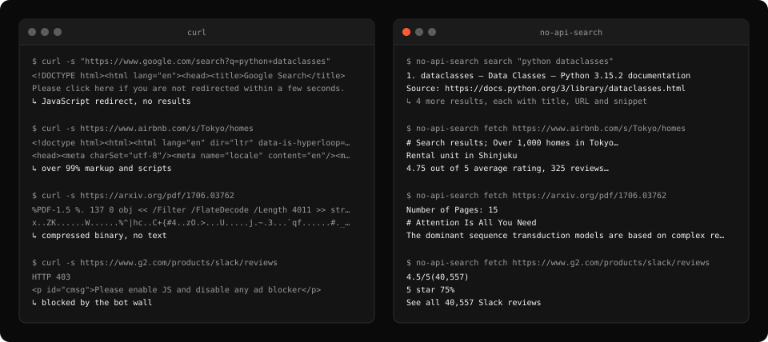
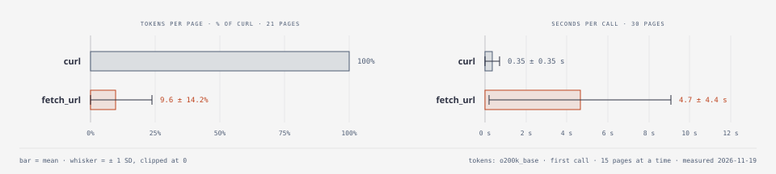

# no-api-search

Free web search and page reading for local AI agents: clean markdown from web pages, including JavaScript pages, PDFs and many bot-walled sites, with no API key.





On 30 public pages (docs, news, GitHub, papers, JavaScript apps, bot-walled sites), fetch_url returned the page for 27 and curl for 21. Where both did, fetch_url used 9.6% of curl's tokens on average: MDN's HTTP status page is 63,258 tokens with curl and 2,833 with fetch_url. A fetch_url call took 4.7 s on average, curl 0.35 s.

## Install

Requires [uv](https://docs.astral.sh/uv/getting-started/installation/).

**pi**

```bash
pi install git:github.com/tctsung/no-api-search
```

**opencode**: add to `~/.config/opencode/opencode.json`

```json
{
  "$schema": "https://opencode.ai/config.json",
  "mcp": {
    "web": {
      "type": "local",
      "command": ["uvx", "--from", "git+https://github.com/tctsung/no-api-search", "no-api-search", "mcp"]
    }
  }
}
```

**Codex**

```bash
codex mcp add web -- uvx --from git+https://github.com/tctsung/no-api-search no-api-search mcp
```

The agent starts the server when a session starts and stops it when the session ends; there is no daemon and no open port. The first start takes about 4 s while uv builds an isolated environment (5 packages, 33 MB), later starts under 1 s. Nothing is installed into your Python.

## Tools

| Function | Arguments | Returns |
|---|---|---|
| `web_search` | `query`, `max_results=5` | Numbered results: title, URL, snippet |
| `fetch_url` | `url`, `offset=0`, `max_chars=20000` | Page as markdown, link URLs removed; when truncated, a note with the next `offset` |

### CLI

Same argument names as the tools:

```bash
uv tool install git+https://github.com/tctsung/no-api-search
no-api-search search "python dataclasses" --max_results 5
no-api-search fetch https://arxiv.org/pdf/1706.03762 --offset 20000 --max_chars 20000
```

## How it works

`web_search` sends one request to DuckDuckGo's HTML page. If DuckDuckGo answers with a bot challenge, the query goes to [ddgs](https://github.com/deedy5/ddgs), which searches up to seven other engines (Brave, Yahoo, Mojeek and others) and merges their results.

`fetch_url` asks [Jina Reader](https://jina.ai/reader) for the page; Jina loads it in a browser, so JavaScript runs and PDFs become text. If Jina returns an error, a 403/404/CAPTCHA warning or a placeholder page, [markdown.new](https://markdown.new) tries next, which gets through some bot walls. If both fail, ddgs fetches the page directly from your machine, without JavaScript. Each step runs only when the previous one fails, so a typical call makes one request.

## Limits

- Queries go to DuckDuckGo, or to the engines ddgs uses. Fetched URLs go to `r.jina.ai`, then `markdown.new`. Do not search for or fetch confidential content.
- Keyless quotas: Jina 20 requests per minute, markdown.new 500 per day per IP.
- Search engines challenge datacenter and corporate IP ranges more often than residential ones.
- opencode 1.19.6 sends SIGTERM to every process you own when `opencode mcp list` or `opencode models` stops a stdio MCP server. This happens with any server, not only this one. Do not run those two commands until opencode fixes it.
